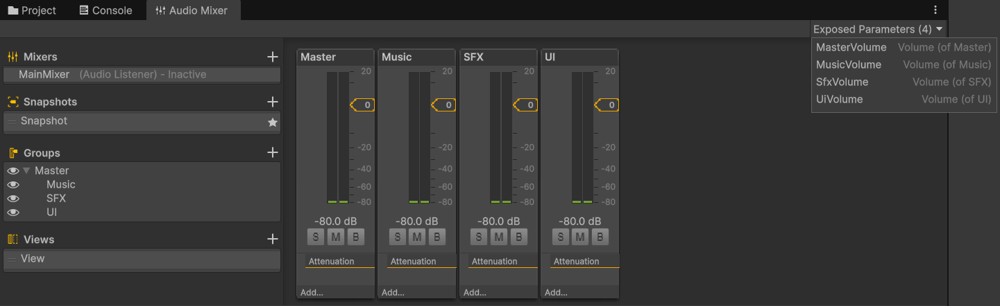

# The Wandering Blade - CS464 Lab 08

**Name:** Muhammad Abdullah Usman
**Roll Number:** BSCS25061

Lab 08 builds on the Lab 07 ten-screen mobile menu project and extends it into a playable game flow:
launch -> menus -> loading -> gameplay -> pause/settings -> results -> retry/menu.

- **Demo video:** [VIDEO LINK]
- **Windows build:** [BUILD LINK] (extract the whole ZIP, then run the .exe)

## Unity Version
6000.3.24f1 (Unity 6.3 LTS)

## Setup Steps
1. Clone this repository.
2. Open the folder through Unity Hub with Unity 6000.3.24f1.
3. Open `Assets/Scenes/MainMenu.unity` and press Play (landscape Game view, e.g. 1920 x 1080).
4. Controls: WASD to move, Space or the STRIKE button to strike, Esc or the II button to pause.

Scenes in the build list: `MainMenu` (0), `Gameplay` (1).

## Loading Flow
1. Main Menu -> Chapter Select -> Mission Briefing -> Equipment -> **Begin Mission**.
2. The chosen chapter (strike target, time limit, reward) and the equipped weapon and strike cooldown are stored in the static `GameSession` class so they survive the scene change.
3. `SceneLoader` shows the loading screen and calls `SceneManager.LoadSceneAsync("Gameplay")` with `allowSceneActivation = false`.
4. The bar and percentage show the real progress, `Mathf.Clamp01(op.progress / 0.9f)`.
5. Only when progress reaches 0.9 does the bar show 100% and `allowSceneActivation` become `true`, so the player cannot enter gameplay before loading is complete.

Retry and Main Menu on the Pause and Results screens use the same loader.

## Audio Mixer Groups


One mixer, `MainMixer`:

| Group | Exposed parameter | AudioSources routed to it |
|---|---|---|
| Master | `MasterVolume` | Parent of Music, SFX and UI |
| Music | `MusicVolume` | `MusicManager` (2 sources, used for crossfading) |
| SFX | `SfxVolume` | `SfxPlayer` (4 sources, gameplay effects) |
| UI | `UiVolume` | `UIAudio` (1 reusable source for every UI sound) |

**UI sounds:** `UIAudio` is one reusable player, with no AudioSource on any button. It plays hover (pointer enter), press, back, panel open, pause, resume, success (equip, upgrade, mission complete) and error (unaffordable upgrade, mission failed). `UIManager` triggers open and back; `UIButtonFeedback` triggers hover and press on every button.

**Gameplay sounds:** `SfxPlayer` uses `PlayOneShot` so overlapping effects don't cut each other off, with a random pitch of ±2 semitones on every play. Sounds: sword swing, strike hit, damage, orb pickup and death.

## Volume Mapping
Settings (main menu) and the in-game Pause screen share one `VolumePanel` prefab with Master, Music, SFX and UI sliders.

- Each slider runs from **0.0001 to 1** and is converted to decibels logarithmically: `Mathf.Log10(value) * 20`.
- 1 = 0 dB, 0.5 = -6 dB, 0.1 = -20 dB.
- **Safe mute:** at the slider minimum the code sets **-80 dB** directly, so `Log10` is never called on 0.
- Each value is saved in **PlayerPrefs** (`MasterVolume`, `MusicVolume`, `SfxVolume`, `UiVolume`, default 0.8) and applied by `MusicManager` on launch, so settings persist after restarting the game.

**Audio while paused:** pausing sets `Time.timeScale = 0` and `AudioListener.pause = true`, which stops gameplay SFX. The Music and UI sources use `ignoreListenerPause`, so the music keeps playing and pause-menu buttons and sliders still give audible feedback.

## Music Transitions
`MusicManager` is a single persistent instance (DontDestroyOnLoad with a singleton check) that owns two looping AudioSources. A `MusicCue` in each scene requests that scene's track. When the gameplay scene starts, the menu track is **crossfaded** into the gameplay track over 1.5 seconds on unscaled time.

## C# Events

**Core system refactored:** the player's `Health` no longer controls the UI, sound or flash directly. It only raises events, and independent listeners respond.

| Publisher | Events | Subscribers |
|---|---|---|
| `Health` | `Damaged`, `Healed`, `Died` | `HealthBarUI` (health bar), `HitFlash` (red screen flash), `GameSounds` (hurt and death sounds), `MissionGame` (Died → mission lost) |
| `MissionGame` | `StrikeLanded`, `GameWon`, `GameLost` | `GameHUD` (strike counter), `GameSounds` (strike hit sound), `ResultsPanel` (results screen) |
| `PlayerStrike` | `Swung` | `GameSounds` (swing sound) |
| `SpiritOrb` (static) | `Collected` | `GameSounds` (pickup sound) |

Every subscriber uses `+=` in `OnEnable` and `-=` in `OnDisable`, and every event is raised with `?.Invoke(...)`.

**Code excerpt:**
```csharp
// Health.cs - declaration and invocation
public event Action<int, int> Damaged;

public void TakeDamage(int amount)
{
    if (current <= 0 || Time.time < invulnerableUntil) return;

    current = Mathf.Max(0, current - amount);
    invulnerableUntil = Time.time + invulnerableTime;
    Damaged?.Invoke(current, maxHealth);

    if (current == 0) Died?.Invoke();
}

// HitFlash.cs - subscribe / unsubscribe pair
void OnEnable() { health.Damaged += Flash; }
void OnDisable() { health.Damaged -= Flash; }
```

## Credits
**Audio**
- "8bit Bossa" (Bossa Nova) . Joth . https://opengameart.org/content/bossa-nova . CC0: menu music
- "The Field Of Dreams" . pauliuw . https://opengameart.org/content/the-field-of-dreams . CC0: gameplay music
- Interface Sounds, Impact Sounds, Digital Audio, Music Jingles . Kenney . https://kenney.nl/assets . CC0: UI and gameplay sound effects

**Other assets**
- DOTween . Demigiant . https://dotween.demigiant.com . free version
- Spectral and Barlow fonts . Google Fonts . SIL Open Font License